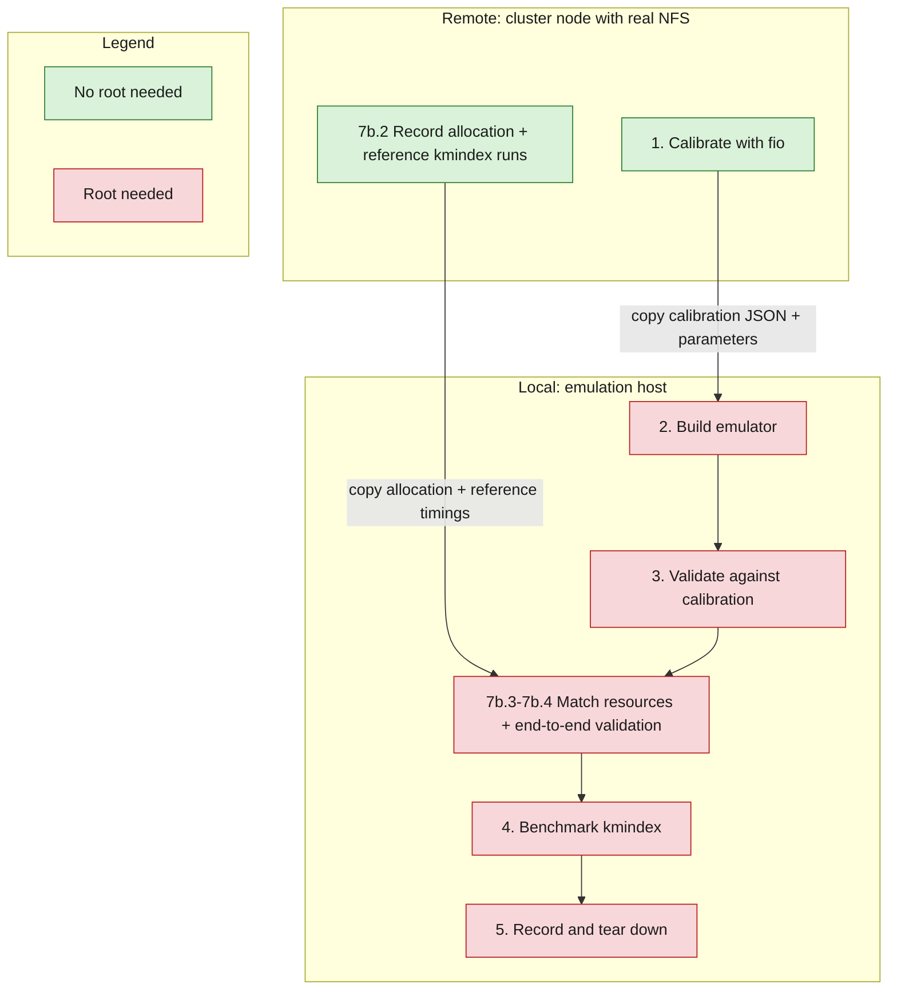
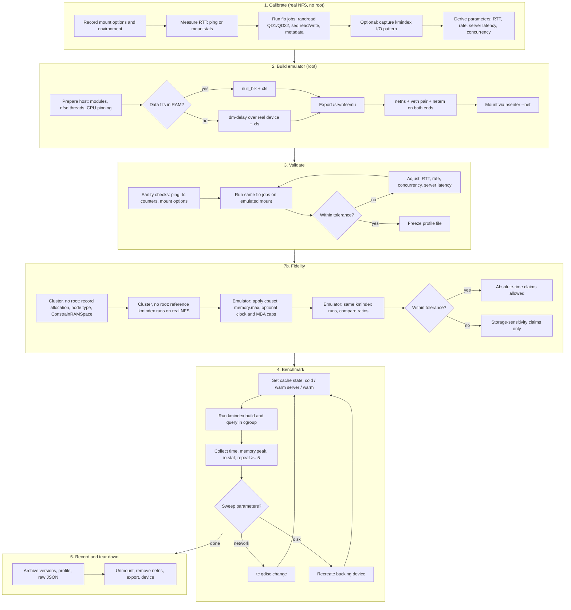

# NFS emulation protocol for kmindex benchmarking

Rigor level: research protocol, prototype tooling. Scripts are meant to be
versioned with the benchmark repository, not released as a tool.

Goal: reproduce the I/O behavior of a real NFS mount on a single Linux host,
with tunable network and server-disk parameters, so that kmindex indexing and
query benchmarks can be run under controlled, repeatable storage conditions.

## Overview

The protocol has five phases:

1. **Calibrate** (sections 1.1-1.5, no root): measure the real NFS mount with
   fio (latency, IOPS, throughput, metadata) and derive emulation parameters.
2. **Build the emulator** (sections 2-6, root): create a server disk with
   delayed completions, export it over NFS, shape a veth link with netem, and
   mount it through a dedicated network namespace.
3. **Validate** (section 7): run the same fio jobs on the emulated mount,
   compare to calibration, and iterate until within a fixed tolerance. Freeze
   the parameters in a profile file. Then (section 7b) match the cluster's
   job allocation (cores, memory, optionally clock and memory bandwidth) and
   compare kmindex end-to-end runs against reference runs on the real NFS.
4. **Benchmark** (section 8): run kmindex indexing and queries under defined
   cache states, recording time, peak memory and I/O; optionally sweep
   network and disk parameters.
5. **Record and tear down** (sections 9-10): archive the configuration and raw
   results, then remove the emulator.

### Main steps

Remote: cluster node with access to the real NFS mount.
Local: dedicated emulation host (node or VM) with root access.



Steps 3 and 4 need root because they drop the page cache and create cgroups;
the fio and kmindex processes themselves can run unprivileged.

### Detailed flowchart



### Emulator topology

```
root netns                                       netns "nfscli"
---------------------------------------------    ---------------------------
null_blk or dm-delay   (server disk latency)
  -> xfs on /srv/nfsemu
  -> nfsd exports /srv/nfsemu
     veth-s 10.99.0.1  [netem egress] <------->  veth-c 10.99.0.2 [netem egress]
/mnt/nfsemu  <- NFS mount, transport bound to nfscli (mounted via nsenter --net)
benchmarks run here, against /mnt/nfsemu
```

The NFS client binds its RPC transport to the network namespace of the
mounting process. Mounting with `nsenter --net=...` (network namespace only)
makes the mount visible in the root mount namespace while all traffic crosses
the shaped veth link.

---

## 0. Requirements

| Phase | Machine | Root | Packages |
|---|---|---|---|
| 1. Calibration | cluster node with the real NFS mount | no | `fio` (>= 3.13 for metadata engines), `nfs-utils` client tools (`mountstats`, `nfsiostat`) |
| 2-8. Emulation | dedicated node or VM | yes | `fio`, `nfs-kernel-server` (Debian/Ubuntu) or `nfs-utils` (RHEL/Fedora), `iproute2`, `xfsprogs`, `util-linux` (`nsenter`), optionally `vmtouch`, `hyperfine` |

Kernel modules on the emulation host: `null_blk`, `nfsd`, `nfs`, `veth`,
`sch_netem`, and `dm_delay` if used. Check with `modinfo <name>`.

Memory: a memory-backed `null_blk` consumes RAM equal to the data written.
If the index plus kmtricks temporary files does not fit in RAM with margin,
use the `dm-delay` back-end (section 3b).

---

## 1. Calibrate on the real NFS (no root)

### 1.1 Record the mount configuration

```bash
TARGET=/path/on/real/nfs/fio-calib      # directory on the NFS share
mkdir -p "$TARGET"
mnt=$(findmnt -n -o TARGET -T "$TARGET")
findmnt -n -o SOURCE,FSTYPE,OPTIONS -T "$TARGET" > calib/mount.txt
nproc > calib/nproc.txt; uname -r > calib/kernel.txt; fio --version > calib/fio.txt
```

Keep `vers`, `rsize`, `wsize`, `nconnect`, `actimeo`, `hard`/`soft`: the
emulated mount must use the same options (section 6).

### 1.2 Measure network RTT

```bash
server=$(findmnt -n -o SOURCE -T "$TARGET" | cut -d: -f1)
ping -c 50 -i 0.2 "$server" > calib/ping.txt     # often blocked on clusters
cp /proc/self/mountstats calib/mountstats.before
```

If ICMP is blocked, use the average RTT of lightweight RPCs (GETATTR, ACCESS)
from `mountstats "$mnt"` after the fio runs below. This approximates
network RTT plus a small server-side cost.

### 1.3 fio calibration jobs

`calib.fio`:

```ini
[global]
directory=${TARGET}
filename=fio-calib.dat
size=16g                ; larger than server cache if possible (unknown on shared NFS)
direct=1                ; bypass client page cache (O_DIRECT is supported on NFS)
time_based=1
runtime=60
ramp_time=5
randseed=42
group_reporting=1

[randread-4k-qd1]       ; latency
rw=randread
bs=4k
ioengine=psync
stonewall

[randread-4k-qd32]      ; IOPS under concurrency
rw=randread
bs=4k
ioengine=libaio
iodepth=32
stonewall

[randread-128k-qd1]     ; adjust bs to kmindex's dominant read size (see 1.4)
rw=randread
bs=128k
ioengine=psync
stonewall

[seqread-1m]
rw=read
bs=1m
ioengine=libaio
iodepth=8
stonewall

[seqwrite-1m]
rw=write
bs=1m
ioengine=libaio
iodepth=8
stonewall
```

`calib-meta.fio` (metadata latency, relevant for indexing that creates many
files; engines require fio >= 3.13, check `fio --enghelp`):

```ini
[global]
directory=${TARGET}/meta
nrfiles=5000
filesize=4k
openfiles=1
randseed=42

[create]
ioengine=filecreate
stonewall

[stat]
ioengine=filestat
stonewall
```

Run, 5 repetitions, JSON output with latency histograms:

```bash
mkdir -p "$TARGET/meta" calib
for i in 1 2 3 4 5; do
  TARGET=$TARGET fio --output-format=json+ --output=calib/data.$i.json calib.fio
  TARGET=$TARGET fio --output-format=json+ --output=calib/meta.$i.json calib-meta.fio
done
cp /proc/self/mountstats calib/mountstats.after
mountstats "$mnt" > calib/mountstats.txt
rm -rf "$TARGET"
```

Notes:
- Shared NFS is noisy. Run at different times of day and report the spread;
  pick a representative run (e.g. the median day) as the calibration target.
- `direct=1` removes the client cache but not the server cache. With unknown
  server RAM, treat the measured latency as "server as it behaves in practice".

### 1.4 Capture kmindex's I/O pattern (optional, recommended)

Calibrating block sizes that kmindex never issues is wasted effort. On any
machine, record the size distribution of reads during a query:

```bash
strace -f -e trace=read,pread64,preadv,mmap -o kmindex.strace <kmindex query command>
```

If the index is accessed through `mmap`, reads appear as page faults, not
syscalls; use `perf trace -F maj` or block-layer tracing (`biosnoop` from
bcc) on the emulation host instead. Add matching `bs` values to `calib.fio`.

### 1.5 Derive emulation parameters

| Parameter | Source | Emulator knob |
|---|---|---|
| Network RTT | ping median, else GETATTR avg RTT | netem `delay` = RTT/2 on each veth end |
| Network jitter | ping stddev | netem `delay X Y` (see pitfalls, start without) |
| Throughput cap | `seqread-1m` bandwidth | netem `rate` |
| Server disk latency | `randread-4k-qd1` median latency minus RTT | `null_blk` `completion_nsec`, or `dm-delay` read delay |
| Concurrency | ratio QD32 IOPS / QD1 IOPS | nfsd thread count, `null_blk` `hw_queue_depth`, mount `nconnect` |

These are first estimates. Section 7 iterates until emulated fio matches.

---

## 2. Prepare the emulation host (root)

```bash
modprobe null_blk nr_devices=0       # nr_devices=0: no default nullb0
modprobe nfsd; modprobe nfs; modprobe veth; modprobe sch_netem
mountpoint -q /sys/kernel/config || mount -t configfs none /sys/kernel/config
systemctl enable --now nfs-server     # unit name: nfs-server (RHEL) / nfs-kernel-server (Debian)
cpupower frequency-set -g performance
```

Isolate CPUs: reserve a core set for kmindex and leave the rest to nfsd and
the network stack. Example on a 32-core node: kmindex on 0-23, system on 24-31.

```bash
rpc.nfsd 16                           # fixed nfsd thread count, recorded
```

If a host firewall is active, allow NFS (TCP 2049) on `veth-s`.

---

## 3a. Server disk back-end: null_blk (data fits in RAM)

```bash
NAME=nfsemu
d=/sys/kernel/config/nullb/$NAME
mkdir "$d"
echo 65536  > "$d/size"               # MB
echo 1      > "$d/memory_backed"
echo 2      > "$d/irqmode"            # timer mode, required for completion_nsec
echo 100000 > "$d/completion_nsec"    # from 1.5
echo 64     > "$d/hw_queue_depth"
echo 1      > "$d/power"
dev=/dev/nullb$(cat "$d/index")
[ -b "$dev" ] || dev=/dev/$NAME       # naming differs across kernels; verify with lsblk
mkfs.xfs -f "$dev"
mkdir -p /srv/nfsemu && mount "$dev" /srv/nfsemu
```

`completion_nsec` cannot be changed after `power=1` (returns EBUSY). Changing
server disk latency requires recreating the device and the filesystem.

## 3b. Server disk back-end: dm-delay over a real device (large data)

```bash
real=/dev/nvme1n1p1                   # dedicated, empty partition
sectors=$(blockdev --getsz "$real")
# read delay 100 us is not expressible: dm-delay takes milliseconds.
dmsetup create nfsemu --table "0 $sectors delay $real 0 1 $real 0 1"
mkfs.xfs -f /dev/mapper/nfsemu
mkdir -p /srv/nfsemu && mount /dev/mapper/nfsemu /srv/nfsemu
```

`dm-delay` granularity is 1 ms, which is coarse for SSD-class servers. If the
calibrated server latency is well below 1 ms, use the bare device (no dm-delay)
and let netem carry the latency budget.

---

## 4. Export

```bash
mkdir -p /etc/exports.d
echo '/srv/nfsemu 10.99.0.2(rw,sync,no_root_squash,no_subtree_check)' \
  > /etc/exports.d/nfsemu.exports
exportfs -ra
```

`sync` vs `async` changes write latency by orders of magnitude. Match the
real server if known (ask the cluster admins); otherwise use `sync` and state it.

---

## 5. Network namespace and shaping

```bash
ip netns add nfscli
ip link add veth-s type veth peer name veth-c
ip link set veth-c netns nfscli
ip addr add 10.99.0.1/24 dev veth-s
ip link set veth-s up
ip -n nfscli addr add 10.99.0.2/24 dev veth-c
ip -n nfscli link set veth-c up
ip -n nfscli link set lo up

# MTU: match the cluster (often 1500 or 9000)
ip link set veth-s mtu 1500
ip -n nfscli link set veth-c mtu 1500

# netem: egress only, so split RTT across both ends.
# limit >= 2 x bandwidth-delay product in packets.
HALF=250us; RATE=1gbit; LIMIT=10000
tc qdisc add dev veth-s root netem delay $HALF rate $RATE limit $LIMIT
ip netns exec nfscli tc qdisc add dev veth-c root netem delay $HALF rate $RATE limit $LIMIT
```

Change network parameters later without remounting:

```bash
tc qdisc change dev veth-s root netem delay 1ms rate 1gbit limit 10000
ip netns exec nfscli tc qdisc change dev veth-c root netem delay 1ms rate 1gbit limit 10000
```

---

## 6. Mount

Use the options recorded in 1.1.

```bash
mkdir -p /mnt/nfsemu
nsenter --net=/run/netns/nfscli \
  mount -t nfs -o vers=4.2,proto=tcp,hard,rsize=1048576,wsize=1048576 \
  10.99.0.1:/srv/nfsemu /mnt/nfsemu
chmod 1777 /mnt/nfsemu
```

---

## 7. Validate against calibration

### 7.1 Sanity checks

```bash
ip netns exec nfscli ping -c 20 10.99.0.1        # RTT ~ 2 x HALF
tc -s qdisc show dev veth-s                       # counters grow during I/O on /mnt/nfsemu
grep nfsemu /proc/self/mountstats | head -1       # mount present, correct options
```

### 7.2 Run the same fio jobs

```bash
mkdir -p /mnt/nfsemu/fio-calib/meta emu
for i in 1 2 3 4 5; do
  sync; echo 3 > /proc/sys/vm/drop_caches
  TARGET=/mnt/nfsemu/fio-calib fio --output-format=json+ --output=emu/data.$i.json calib.fio
  TARGET=/mnt/nfsemu/fio-calib fio --output-format=json+ --output=emu/meta.$i.json calib-meta.fio
done
```

### 7.3 Compare and iterate

Extract per job: median and p99 completion latency (`clat_ns.percentile`),
IOPS, bandwidth. Compare emulated vs calibration.

- Fix an acceptance tolerance before iterating (e.g. medians within 10%),
  and report it.
- Adjust in this order: RTT (netem delay) on `randread-4k-qd1` first, then
  throughput (netem rate) on `seqread-1m`, then concurrency
  (nfsd threads, `hw_queue_depth`, `nconnect`) on `randread-4k-qd32`, then
  server latency (`completion_nsec`) last.
- Expect tails (p99) to be lower on the emulator: it has no competing users.
  Report the gap instead of forcing it with jitter.

Freeze the final parameters in a profile file:

```bash
# profiles/cluster-nfs.env
HALF=250us
RATE=1gbit
LIMIT=10000
JITTER=
COMPLETION_NSEC=100000
HW_QUEUE_DEPTH=64
NFSD_THREADS=16
MOUNT_OPTS=vers=4.2,proto=tcp,hard,rsize=1048576,wsize=1048576
EXPORT_OPTS=rw,sync,no_root_squash,no_subtree_check
```

---

## 7b. Fidelity: resource matching and end-to-end validation

Matching fio results (section 7) proves only that the emulated *storage*
behaves like the real NFS for the calibrated patterns. kmindex end-to-end
times also depend on page cache size, CPU, and memory bandwidth. This section
lists what must be matched, where each piece of information comes from, and
which conclusions are allowed.

### 7b.1 What the emulator reproduces

| Factor | Emulator control | Fidelity |
|---|---|---|
| Network RTT, bandwidth | netem | good, after calibration |
| Server disk latency | `null_blk` / `dm-delay` | good for latency, no SSD internals |
| NFS protocol behavior | real kernel client and nfsd | good |
| Client page cache size | cgroup `memory.max` | good |
| Server page cache size | eviction, host RAM limit | partial |
| Core count | cgroup `cpuset.cpus`, `cpu.max` | good |
| Clock frequency | `cpupower frequency-set --max` | partial (turbo, power limits differ) |
| Memory bandwidth, LLC share | `resctrl` (MBA, CAT), NUMA binding | coarse, hardware-dependent |
| Microarchitecture (IPC, caches, SIMD) | none | none: use the same node type |
| Contention from other users | none | none: emulated tails are a lower bound |

The single most effective measure is to run the emulator on the **same node
type** as the cluster compute nodes (reserved node with root, or a VM on that
hardware). Then the CPU and memory rows reduce to applying the same limits.

### 7b.2 Real cluster side (remote, no root)

Record the resources that a kmindex job actually gets on the cluster.

```bash
mkdir -p cluster
lscpu > cluster/lscpu.txt
numactl -H > cluster/numa.txt
cat /proc/meminfo > cluster/meminfo.txt
ls /sys/fs/resctrl/info > cluster/resctrl.txt 2>/dev/null   # RDT support, if mounted
scontrol show config | grep -Ei 'cgroup|TaskPlugin|JobAcct' > cluster/slurm.txt
cat /etc/slurm/cgroup.conf > cluster/cgroup.conf 2>/dev/null
```

Determine:
- **Job allocation**: cores (`--cpus-per-task`) and memory (`--mem`) used for
  kmindex jobs.
- **Whether page cache counts against `--mem`**: true when `cgroup.conf` has
  `ConstrainRAMSpace=yes` (cgroup v2 charges page cache to the job). If the
  cluster does not constrain RAM, the job sees the node's full page cache;
  record node RAM instead.
- **Node type**: CPU model, sockets, NUMA nodes, RAM.

Run **reference kmindex runs on the real NFS** (one or two dataset sizes small
enough to also run on the emulator), inside a normal Slurm allocation:

```bash
# inside an allocation: srun --cpus-per-task=N --mem=M ...
vmtouch -e /real/nfs/index/                         # evict client cache, unprivileged
/usr/bin/time -v -o cluster/query.$i.time <kmindex query command>
sacct -j "$SLURM_JOB_ID" --format=JobID,MaxRSS,AveCPU,Elapsed -P > cluster/sacct.$i.txt
```

Cache-state limits on the cluster:
- Cold client: `vmtouch -e` (posix_fadvise DONTNEED) works without root.
- Server cache: not controllable. The real runs are "cold client, unknown
  server". Use the "cold client, warm server" state on the emulator as the
  comparable condition, and repeat cluster runs to see the spread.
- `MaxRSS` from `sacct` depends on `JobAcctGatherType`; record which one.

### 7b.3 Emulator side (local, root)

Apply the same allocation to the benchmark cgroup. Add to the profile file:

```bash
# profiles/cluster-nfs.env (continued)
CPUS=0-15                 # same core count as --cpus-per-task, one NUMA node if the job is
MEM_MAX=64G               # = --mem if ConstrainRAMSpace=yes, else node RAM
CPU_MAX_FREQ=             # optional, e.g. 2.4GHz to approximate a lower base clock
MBA_PERCENT=              # optional, resctrl memory bandwidth cap
```

Enable controllers once:

```bash
echo "+cpuset +cpu +memory +io" > /sys/fs/cgroup/cgroup.subtree_control
[ -n "$CPU_MAX_FREQ" ] && cpupower frequency-set --max "$CPU_MAX_FREQ"
```

Optional memory bandwidth cap (Intel RDT or AMD QoS; check
`/sys/fs/resctrl/info/MB` first; values are percentages in coarse steps):

```bash
mountpoint -q /sys/fs/resctrl || mount -t resctrl resctrl /sys/fs/resctrl
mkdir -p /sys/fs/resctrl/kmbench
echo "MB:0=$MBA_PERCENT;1=$MBA_PERCENT" > /sys/fs/resctrl/kmbench/schemata
# assign tasks by writing PIDs to /sys/fs/resctrl/kmbench/tasks
```

Server page cache (nfsd runs in the root cgroup and is not limited by
`memory.max`):
- cold server: `vmtouch -e /srv/nfsemu` or `drop_caches` before each run;
- bounded server cache: limit host RAM (`mem=` boot parameter, or run the
  emulator in a VM) and report the value.

The `run()` helper in section 8.2 applies `CPUS` and `MEM_MAX`.

### 7b.4 End-to-end validation

On the emulator, repeat the reference workload from 7b.2 with the same
dataset, kmindex version, thread count, allocation, and the comparable cache
state. For each metric (wall time, peak memory), compute the ratio
`emulated / real` on medians, and report it with the cluster spread.

Fix the tolerance before comparing. Then:

| Outcome | Allowed claims |
|---|---|
| Ratio within tolerance, same node type | emulated absolute times approximate the cluster for this workload |
| Ratio within tolerance, different node type | as above, but only for the validated dataset sizes; state the hardware difference |
| Ratio outside tolerance | storage-sensitivity results only (how times scale with latency and bandwidth), no absolute-time claims |

Peak memory should match closely when allocations match; a mismatch usually
points to a page-cache accounting difference (7b.2) rather than storage.

---

## 8. Run the kmindex benchmarks

### 8.1 Cache states

Client and server share one kernel, so `drop_caches` empties both.

| State | Procedure before each run |
|---|---|
| Cold client, cold server | `sync; echo 3 > /proc/sys/vm/drop_caches` |
| Cold client, warm server (typical real NFS) | drop caches, then read index files via `/srv/nfsemu` (`vmtouch -t` or `cat > /dev/null`) |
| Warm | one discarded run first |

### 8.2 Measurement

Run each benchmark in its own cgroup to get peak memory including page cache
(`memory.peak` requires kernel >= 5.19), plus `/usr/bin/time -v` for RSS
and `/proc/<pid>/io` for bytes read:

```bash
run() {  # run <label> <cmd...>
  local label=$1; shift
  local cg=/sys/fs/cgroup/kmbench-$label-$$
  mkdir "$cg"
  echo "$CPUS"    > "$cg/cpuset.cpus"     # from profile, see 7b.3
  echo "$MEM_MAX" > "$cg/memory.max"      # caps anon + page cache
  ( echo $BASHPID > "$cg/cgroup.procs"
    exec /usr/bin/time -v -o "results/$label.time" "$@" )
  cat "$cg/memory.peak" > "results/$label.mempeak"
  cat "$cg/io.stat"     > "results/$label.iostat"
  rmdir "$cg"
}
```

- At least 5 repetitions per configuration; report median and IQR.
- For query benchmarks, report single-query latency and batched throughput
  separately, sweeping kmindex's thread count.
- Indexing: place both the index output and kmtricks temporary directory on
  `/mnt/nfsemu` only if that matches real usage; otherwise put temp files on
  local storage and state it.

### 8.3 Parameter sweeps

Network sweeps use `tc qdisc change` (no remount). Server disk sweeps require
recreating the `null_blk` device (section 3a) and re-copying the index.

---

## 9. Teardown

```bash
umount /mnt/nfsemu
rm /etc/exports.d/nfsemu.exports && exportfs -ra
ip netns del nfscli                               # removes the veth pair
umount /srv/nfsemu
echo 0 > /sys/kernel/config/nullb/nfsemu/power && rmdir /sys/kernel/config/nullb/nfsemu
# or: dmsetup remove nfsemu
```

---

## 10. Reproducibility record (store with every result set)

- `uname -r`, distribution, CPU model, NUMA layout (`lscpu`, `numactl -H`)
- versions: fio, nfs-utils, iproute2, kmindex, kmtricks (commit hashes)
- profile file (section 7.3), mount options as actually applied (`findmnt`)
- `tc -s qdisc show` for both veth ends, null_blk configfs attributes
- calibration raw JSON and the emulated validation JSON
- cache state, CPU pinning, nfsd thread count, repetition count

---

## 11. Limitations

- No contention from other users: tail latency and its variance are
  underestimated, which is the main real-world NFS effect. Keep real-NFS
  measurements as reference points in the paper.
- `null_blk` applies fixed per-request latency; no SSD internals (garbage
  collection, write amplification). Indexing times are a lower bound.
- `dm-delay` has 1 ms granularity.
- Client and server share CPUs and memory bandwidth despite pinning.
- veth has no NIC behavior (interrupt coalescing, hardware offloads).
- Server page cache size is not modeled; it is whatever the host provides.

### Pitfalls

- netem `limit` too small for the bandwidth-delay product causes drops; you
  then measure TCP loss recovery.
- netem jitter can reorder packets, which TCP may treat as loss. Check
  `nstat -az | grep -i reorder` if jitter is enabled.
- Default systemd NFS units run in the root namespace; do not start a second
  nfsd in `nfscli`.

---

## 12. Existing tools and container images

No turnkey tool for "emulated NFS with calibrated latency" was found. Relevant
building blocks:

- **erichough/nfs-server** (Docker Hub, Alpine-based, NFSv3/v4): containerized
  NFS server. It still uses the host kernel `nfsd` and `nfs` modules and needs
  `--cap-add SYS_ADMIN` or `--privileged`, so it does not remove the root
  requirement. Forks exist (e.g. `ghcr.io/obeone/nfs-server`, multi-arch).
  Maintenance status should be checked before use.
- **Pumba** (`ghcr.io/alexei-led/pumba`): applies netem delay, loss and rate
  to a container's interface. It shapes egress only of the target container,
  so a server container gets delay in one direction; apply the other half on
  the host side. Combined with the NFS server image above, this reproduces
  sections 4-5 with Docker instead of `ip netns`.
- **Linux `tools/testing/nfsd-io-bench`** (patch posted to kernel mailing
  lists, merge status unverified): fio job files for NFSD I/O modes. They use
  fio's userspace `nfs` engine (libnfs), which bypasses the kernel NFS client,
  so they do not represent kmindex's access path. Useful as job-file reference
  only.

On HPC clusters, Apptainer/Singularity cannot run privileged NFS servers, so
the container route does not help there; a dedicated node or VM with root is
required either way.

### References

- null_blk: Linux kernel `Documentation/block/null_blk.rst`
- netem: `man tc-netem`; https://wiki.linuxfoundation.org/networking/netem
- fio: https://fio.readthedocs.io (ioengines `filecreate`, `filestat`)
- dm-delay: Linux kernel `Documentation/admin-guide/device-mapper/delay.rst`
- erichough/nfs-server: https://hub.docker.com/r/erichough/nfs-server/
- Pumba: https://github.com/alexei-led/pumba
